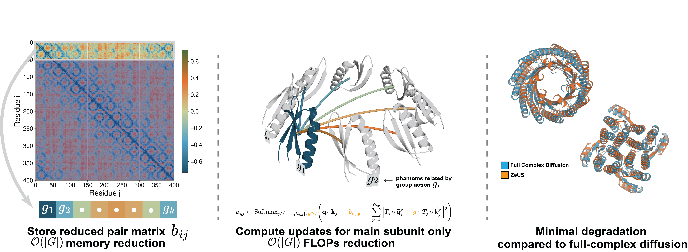

# ZeUS: Zero Shot Unified Symmetrization Generating Symmetric Complexes

ZeUS is an inference-time modification to pretrained protein generative models enabling efficient and scalable generation of symmetric protein assemblies. ZeUS offers a lossless $O(k)$ reduction in time and max memory, for SE3-equivariant and chain-permutation-equivariant models, where $k$ is the order of the symmetry group to be generated. 

This repo includes implementations of the symmetry-aware IPA and Axial-Attention algorithms in the paper, for FrameDiff, FoldFlow-1,
and RFdiffusion. 
<p align="center">
  
</p>

> **Paper:** [Efficient and Accurate Zero Shot Generation of Symmetric Protein Complexes](https://arxiv.org/abs/2611.10424)
## Install

We use uv for package management. Install [uv](https://docs.astral.sh/uv/getting-started/installation/), then run
these commands **from the repository root**. 
```bash
uv sync --project environments/framediff
uv sync --project environments/foldflow
uv sync --project environments/rfdiffusion
uv sync --project environments/refold
```

## Download model weights

Run the following commands from the
repository root to use the paths in the examples below.

| Base Model | Local path | Source |
|---|---|---|
| FrameDiff | `weights/paper_weights.pth` | [FrameDiff paper weights](https://github.com/jasonkyuyim/se3_diffusion/blob/master/weights/paper_weights.pth) |
| FoldFlow-1 | `weights/foldflow-base.pth` | [FoldFlow 0.1.0 release](https://github.com/DreamFold/FoldFlow/releases/tag/0.1.0) |
| RFdiffusion | `weights/Base_ckpt.pt` | [RFdiffusion setup instructions](https://github.com/RosettaCommons/RFdiffusion#getting-started--installation) |
| ProteinMPNN | `weights/protein_mpnn/v_48_020.pt` | [ProteinMPNN vanilla model weights](https://github.com/dauparas/ProteinMPNN/blob/main/vanilla_model_weights/v_48_020.pt) |

```bash
mkdir -p weights/protein_mpnn

# FrameDiff
curl -fL --retry 3 -o weights/paper_weights.pth \
  https://raw.githubusercontent.com/jasonkyuyim/se3_diffusion/master/weights/paper_weights.pth

# FoldFlow-1
curl -fL --retry 3 -o weights/foldflow-base.pth \
  https://github.com/DreamFold/FoldFlow/releases/download/0.1.0/foldflow-base.pth

# RFdiffusion
curl -fL --retry 3 -o weights/Base_ckpt.pt \
  https://files.ipd.uw.edu/pub/RFdiffusion/6f5902ac237024bdd0c176cb93063dc4/Base_ckpt.pt

# ProteinMPNN (for refolding)
curl -fL --retry 3 -o weights/protein_mpnn/v_48_020.pt \
  https://raw.githubusercontent.com/dauparas/ProteinMPNN/main/vanilla_model_weights/v_48_020.pt
```
## Generation

```bash
CUDA_VISIBLE_DEVICES=X uv run --project "environments/<model>" zeus generate \
  --model "<model>" --mode "<mode>" --symmetry "<symmetry>" \
  --subunit-length "<residues-per-subunit>" --num-designs "<num-designs>" \
  --checkpoint "<checkpoint-path>" --output "<output-dir>"
```

| Argument | Values | Default |
|---|---|---|
| `--project` | `environments/framediff`, `environments/foldflow`, or `environments/rfdiffusion`; match `--model`. | Specify the matching environment. |
| `--model` | `framediff`, `foldflow`, or `rfdiffusion`. | Required. |
| `--mode` | `full` or `zeus` for all models; `ablation` for RFdiffusion only. | `zeus` |
| `--symmetry` | Cyclic `Ck` (e.g. `C6`, with `k` from 1 to 62), or polyhedral `T`, `O`, `I` (12, 24, 60 subunits). | `C6` |
| `--subunit-length` | Residues per subunit. | `50` |
| `--num-designs` | Number of backbones to generate. | `1` |
| `--checkpoint` | Existing checkpoint file for the selected model: e.g. `weights/paper_weights.pth` (FrameDiff), `weights/foldflow-base.pth` (FoldFlow), or `weights/Base_ckpt.pt` (RFdiffusion). | Required. |
| `--output` | New or empty output directory, e.g. `outputs/rfdiffusion_c6`. | Required. |
| `--steps` | Number of diffusion steps. | `500` for FrameDiff; `50` for FoldFlow/RFdiffusion. |
| `--seed` | Random seed. | `123` |
| `--radius` | Symmetry pivot x-coordinate for FrameDiff/FoldFlow (IPA). | `11.55` for IPA. |
| `--face-offset-radius` | Face radius controlling additional IPA polyhedral placement; nonzero values apply only to FrameDiff/FoldFlow. | `0.0` |

Omitting `--symmetry` uses `C6` (six subunits) for all three models.

These examples generate 10 C6 backbones with 50 residues per subunit with
`zeus` mode:

```bash
# FrameDiff
CUDA_VISIBLE_DEVICES=0 uv run --project environments/framediff zeus generate \
  --model framediff --mode zeus --symmetry C6 --subunit-length 50 \
  --num-designs 10 --checkpoint weights/paper_weights.pth \
  --output outputs/framediff_c6

# FoldFlow-1
CUDA_VISIBLE_DEVICES=0 uv run --project environments/foldflow zeus generate \
  --model foldflow --mode zeus --symmetry C6 --subunit-length 50 \
  --num-designs 10 --checkpoint weights/foldflow-base.pth \
  --output outputs/foldflow_c6

# RFdiffusion
CUDA_VISIBLE_DEVICES=0 uv run --project environments/rfdiffusion zeus generate \
  --model rfdiffusion --mode zeus --symmetry C6 --subunit-length 50 \
  --num-designs 10 --checkpoint weights/Base_ckpt.pt \
  --output outputs/rfdiffusion_c6
```

## Refolding

```bash
CUDA_VISIBLE_DEVICES=X uv run --project environments/refold zeus refold \
  --input "<pdb-or-directory>" --output "<output-dir>" \
  --mpnn-weights "<mpnn-weights-dir>" --num-sequences "<num-sequences>"
```

| Argument | Values | Default |
|---|---|---|
| `--project` | `environments/refold` for backbones from any generation model. | Specify the refolding environment. |
| `--input` | Existing PDB file or directory containing PDB files, e.g. `outputs/rfdiffusion_c6`. | Required. |
| `--output` | New or empty output directory, e.g. `outputs/rfdiffusion_c6_refold`. | Required. |
| `--mpnn-weights` | Directory containing `v_48_020.pt`, e.g. `weights/protein_mpnn`. | Required. |
| `--num-sequences` | Sequences to design and refold per backbone. | `8` |
| `--temperature` | ProteinMPNN sampling temperature. | `0.1` |
| `--seed` | Random seed. | `38` |
| `--untied` | Set this flag to design chains independently without symmetry-tying. | Off (tied homomer design). |
| `--chunk-size` | ESMFold attention chunk size. | `128` |
| `--recycles` | ESMFold recycling iterations. | `3` |

ProteinMPNN positions across chains are automatically tied for homomer design.

Example that designs eight sequences per backbone and refolds C6 outputs:

```bash
# FrameDiff backbones
CUDA_VISIBLE_DEVICES=0 uv run --project environments/refold zeus refold \
  --input outputs/framediff_c6 --output outputs/framediff_c6_refold \
  --mpnn-weights weights/protein_mpnn --num-sequences 8

# FoldFlow-1 backbones
CUDA_VISIBLE_DEVICES=0 uv run --project environments/refold zeus refold \
  --input outputs/foldflow_c6 --output outputs/foldflow_c6_refold \
  --mpnn-weights weights/protein_mpnn --num-sequences 8

# RFdiffusion backbones
CUDA_VISIBLE_DEVICES=0 uv run --project environments/refold zeus refold \
  --input outputs/rfdiffusion_c6 --output outputs/rfdiffusion_c6_refold \
  --mpnn-weights weights/protein_mpnn --num-sequences 8
```
